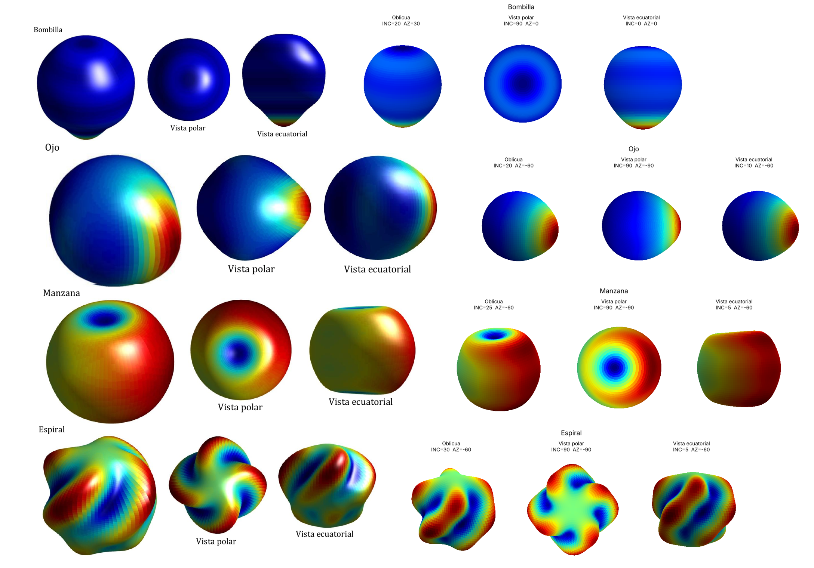
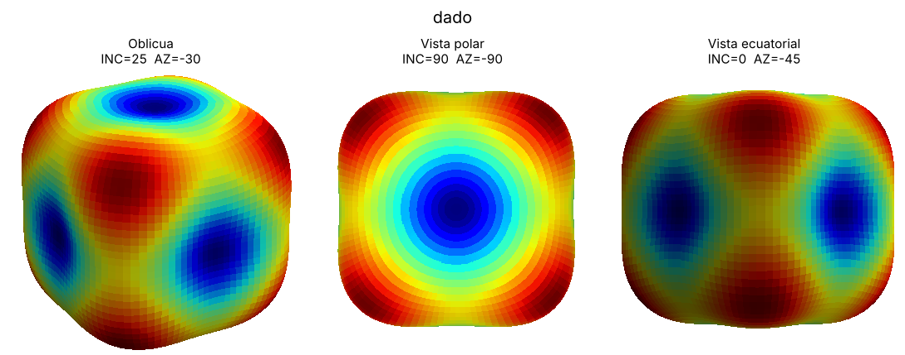
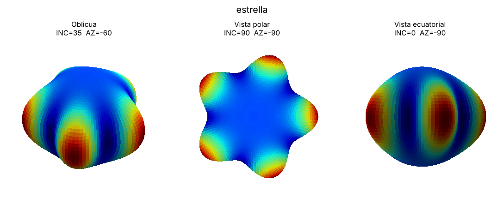

# Práctica 3 — Armónicos esféricos: reconstrucción de formas

**Autor:** Jorge del Río López · Grado en Física, Universidad de Granada
**Asignatura:** Geofísica · Curso 2026-2027

Código y resultados del **apartado b) Suma de armónicos esféricos** de la Práctica 3
(*Armónicos esféricos y geoide*). En él se buscan los coeficientes $(C_{nm}, S_{nm})$, con
$n \le 6$, que reproducen las figuras de la Figura 4 del guion (Bombilla, Ojo, Manzana y
Espiral) y se proponen formas nuevas.



## Enfoque

En lugar de buscar los coeficientes por tanteo o al azar, el problema se trata como un
**análisis armónico**:

1. Se describe la forma buscada mediante una función $f(\theta,\varphi)$, construida con
   piezas simples (máximos, depresiones, bandas, lóbulos) cuyas simetrías coinciden con
   las observadas en la figura.
2. Se calcula su **proyección ortogonal** sobre los armónicos de grado $\le 6$, que es la
   mejor aproximación por mínimos cuadrados sobre la esfera:
   $$C_{nm}=(2-\delta_{m0})\int f\,K_{nm}P_{nm}(\cos\theta)\cos m\varphi\,d\Omega .$$
3. Se ajusta $C_{00}$ para fijar el relieve de la superficie dibujada y se normalizan los
   coeficientes.

Las simetrías de $f$ determinan qué coeficientes son nulos, de modo que el resultado se
puede **predecir y comprobar** antes de calcularlo. Por ejemplo, una figura de revolución
solo tiene términos con $m = 0$, y una simétrica respecto al ecuador solo tiene términos con
$n + m$ par.

- [`docs/metodo.md`](docs/metodo.md): desarrollo matemático completo (normalización,
  proyección, cuadratura, simetrías, truncamiento, relieve, representación).
- [`docs/figuras.md`](docs/figuras.md): razonamiento y coeficientes de cada figura.

## Estructura del repositorio

```
.
├── armonicos.py               Núcleo: síntesis, proyección, relieve, E/S del .dat, dibujo
├── piezas.py                  Piezas para construir funciones objetivo y diagnóstico de simetrías
├── figuras_guion.py           Bombilla, Ojo, Manzana y Espiral (Figura 4 del guion)
├── formas_nuevas.py           Dado, Estrella, Cacahuete y Corazón
├── mi_forma.py                Plantilla para construir una forma nueva
├── explorar.py                Generación de figuras por muestreo aleatorio estructurado
├── interactivo.py             Ajuste manual de coeficientes con deslizadores
├── ejecutar_original.py       Ejecuta el script de la práctica con cualquier .dat
├── spheriharm1_corregido.py   Script de la práctica con iluminación y aspecto 1:1:1
├── generar_todo.py            Regenera todos los resultados
├── original/                  Material de la asignatura, sin modificar (ver original/README.md)
├── docs/                      Documentación del método y de las figuras
├── resultados/
│   ├── dats/                  Coeficientes de cada figura, en el formato de spheriharm1.dat
│   ├── figuras/               Vistas de cada figura y figuras del método
│   ├── exploracion/           Hojas de candidatos por familia
│   ├── script_original/       Salidas del script de la práctica y de la variante corregida
│   └── coeficientes_figuras.tex  Tablas de coeficientes para LaTeX
└── tests/                     Comprobaciones del método
```

## Instalación

Requiere Python ≥ 3.9.

```bash
python -m venv .venv
source .venv/bin/activate          # Windows: .venv\Scripts\activate
pip install -r requirements.txt
```

## Uso

Todos los comandos se ejecutan desde la raíz del repositorio.

```bash
# Regenerar todos los resultados (~40 s)
python generar_todo.py

# Figuras del guion: coeficientes, figuras y tabla LaTeX
python figuras_guion.py            # o una sola: python figuras_guion.py espiral

# Comprobar un .dat con el script de la práctica (sin modificar original/)
python ejecutar_original.py resultados/dats/manzana.dat 25 -60
python ejecutar_original.py resultados/dats/manzana.dat 25 -60 --corregido

# Construir una forma propia: editar FORMA y Q en mi_forma.py y ejecutar
python mi_forma.py

# Explorar figuras nuevas
python explorar.py --familia espiral --n 12 --semilla 3

# Ajustar coeficientes a mano
python interactivo.py resultados/dats/espiral.dat C44 S54 C64 C00

# Ejecutar las comprobaciones
python -m pytest -q                # o, sin pytest: python tests/test_armonicos.py
```

Los ficheros de `resultados/dats/` se pueden usar directamente con el script de la
práctica copiándolos como `spheriharm1.dat`. `ejecutar_original.py` lo hace en un directorio
temporal.

## Resultados

| Figura | Simetría | Coeficientes no nulos (sin contar $C_{00}$) |
|---|---|---|
| Bombilla | revolución | $C_{10}$ … $C_{50}$, de signos alternos |
| Ojo | axisimétrica respecto a un eje ecuatorial | 14 términos, todos con $n+m$ par; $S_{nm}=0$ |
| Manzana | ecuatorial y par en $\varphi$ | $C_{11}, C_{20}, C_{22}, C_{33}, C_{40}, C_{60}$ |
| Espiral | giros de 90° | $C_{44}, S_{44}, C_{54}, S_{54}, C_{64}, S_{64}$ (solo $m=4$) |

Las tablas completas, con su justificación, están en [`docs/figuras.md`](docs/figuras.md) y en
`resultados/coeficientes_figuras.tex`.

**Formas nuevas** (`formas_nuevas.py`): dado (simetría cúbica), estrella de cinco puntas,
cacahuete y corazón.

| Dado | Estrella |
|---|---|
|  |  |

## Verificación

`tests/test_armonicos.py` comprueba:

- que la síntesis y la lectura del `.dat` coinciden exactamente con las de `original/spheriharm1.py`;
- que la proyección recupera coeficientes conocidos con error $<10^{-10}$ y que se cumple el teorema de adición;
- que `fijar_relieve` solo modifica $C_{00}$ y deja el radio mínimo y máximo en los valores indicados;
- que la pieza `crater` produce una depresión visible en la silueta y un hoyo simple no;
- que cada figura tiene exactamente los coeficientes nulos que predicen sus simetrías;
- que, para el dado, $C_{44}/C_{40}=2\sqrt{5/14}$ con error $<10^{-8}$, valor que impone la simetría cúbica;
- que los `.dat` publicados en `resultados/` son los que genera el código.

## Observaciones sobre el script de la práctica

- **Fase de Condon-Shortley.** `scipy.special.lpmv` incluye el factor $(-1)^m$, de modo que
  $C_{11}>0$ sitúa el máximo en $\varphi=180^\circ$.
- **$C_{00}$ y el relieve.** La superficie es $\rho=0.1\,(10+f/\max f)$. $C_{00}$ no cambia los
  colores, pero sí cuánto se hunden las zonas de menor valor. Si $\max f\le 0$, la figura diverge o se invierte.
- **Escala.** Multiplicar todos los coeficientes por $\lambda>0$ no cambia la figura. Los
  coeficientes se presentan normalizados a $\max|c|=10$.
- **Representación.** matplotlib comprime el eje $z$ un 25 % (caja 4:4:3) y la superficie no
  tiene sombreado. `spheriharm1_corregido.py` corrige ambas cosas sin alterar el cálculo.
- **Resolución.** Con $n\le 6$, el detalle angular mínimo es de unos 30°.

## Material de terceros

`original/` contiene el script `spheriharm1.py` y el fichero `spheriharm1.dat` proporcionados
en la asignatura, y recortes de la Figura 4 del guion de la práctica. Se incluyen sin
modificaciones como referencia; su autoría corresponde a sus autores (ver
[`original/README.md`](original/README.md)).
