# Figuras: razonamiento y coeficientes

Para cada figura se sigue el mismo procedimiento:

1. **Observación.** Rasgos visibles en las vistas del guion: dónde están los máximos y
   mínimos y qué simetrías se aprecian.
2. **Simetrías → coeficientes esperados.** Con las reglas de [metodo.md §6](metodo.md#6-simetrías-y-coeficientes-no-nulos)
   se predice qué coeficientes deben ser nulos *antes* de calcular nada.
3. **Función objetivo.** Combinación de piezas con esas simetrías.
4. **Parámetros.** Anchuras, pesos y relieve $q$. A diferencia de los pasos anteriores, no se
   deducen de las simetrías: se ajustaron comparando visualmente la figura obtenida con la
   del guion, probando varios valores de cada uno. Distintas elecciones dan coeficientes
   algo diferentes y figuras muy parecidas. Lo que no depende de esta elección es **qué
   coeficientes son nulos**.
5. **Resultado.** Coeficientes normalizados a $\max|c|=10$ (ficheros en `resultados/dats/`)
   y comprobación de que el patrón de ceros coincide con la predicción del paso 2.

Las tablas listan solo los coeficientes no nulos. La versión LaTeX está en
`resultados/coeficientes_figuras.tex`.

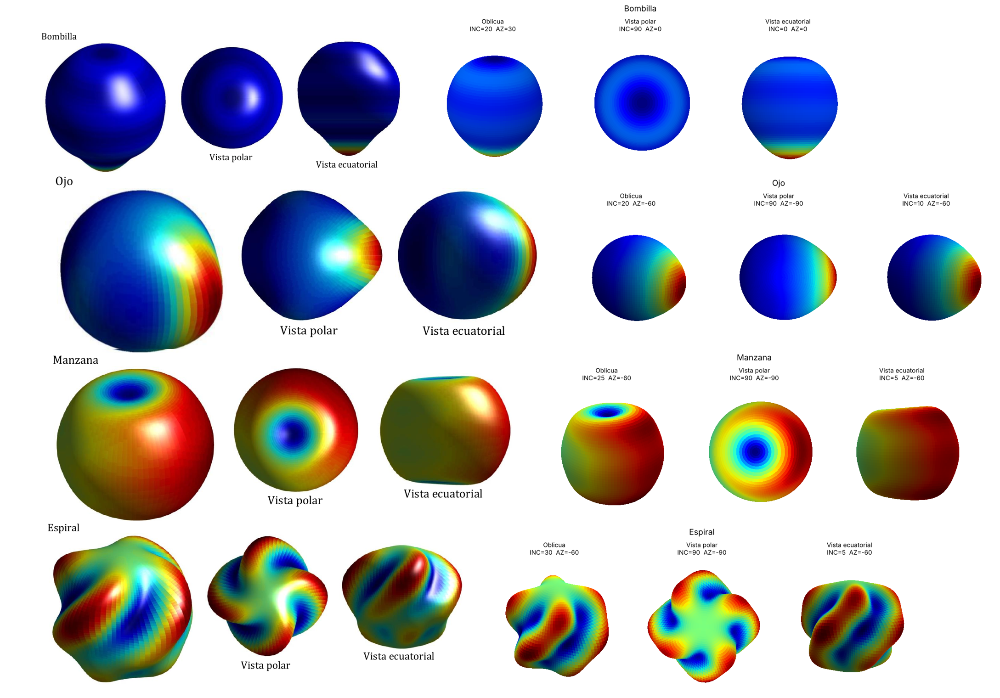

---

## Bombilla

**Observación.** El cuerpo es casi esférico y uniforme. Hay un único máximo estrecho en el
polo sur y, en la vista polar, una pequeña depresión centrada en el polo norte. Las curvas
de color son paralelos.

**Simetría → predicción.** Simetría de revolución en torno a $z$: **solo $m=0$**. Como el
máximo está en un polo y $P_n(-1)=(-1)^n$, los $C_{n0}$ deben alternar de signo.

**Función objetivo.**

```python
BOMBILLA = bulto(-90, 0, ancho=20) + 0.3 * crater(90, 0, ancho=15, borde=0.33, radio_borde=30)
```

Se usa un cráter (sección 9 del método) en lugar de un hoyo para que la depresión del polo
norte sea visible. Relieve $q=1$: radio entre 0.90 y 1.10.

| $n$ | $m$ | $C_{nm}$ | $S_{nm}$ |
|---:|---:|---:|---:|
| 0 | 0 | −10 | 0 |
| 1 | 0 | −2.98 | 0 |
| 2 | 0 | 2.85 | 0 |
| 3 | 0 | −2.87 | 0 |
| 4 | 0 | 1.21 | 0 |
| 5 | 0 | −1.69 | 0 |

Solo hay términos zonales con signos alternos, como se predijo. $C_{60}$ queda por debajo
del umbral del 1 %. Error de truncamiento: 13 %, debido al pico estrecho.

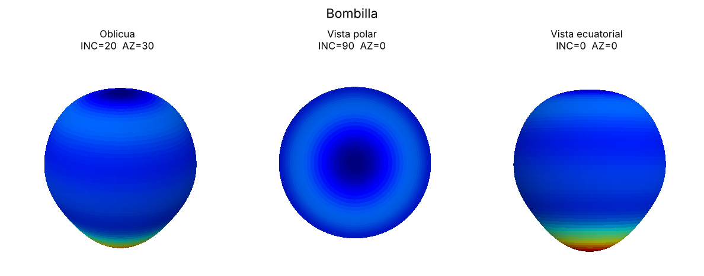

---

## Ojo

**Observación.** Un máximo con punta cónica en el ecuador. Las franjas de color son
rectas tanto en la vista polar como en la ecuatorial, es decir, las curvas de nivel son
planos perpendiculares a un eje ecuatorial.

**Simetría → predicción.** $f$ depende solo de la distancia al punto (lat 0°, lon 0°): es
axisimétrica respecto a ese eje. Por el teorema de adición, $C_{nm}\propto P_{nm}(0)$, que se
anula si $n+m$ es impar, así que **solo $n+m$ par**. El eje está en $\varphi=0$, lo que da
paridad en $\varphi$ y, por tanto, **todos los $S_{nm}=0$**.

**Función objetivo.**

```python
OJO = bulto(0, 0, ancho=40, punta=True)
```

El núcleo exponencial ($e^{-\gamma/\sigma}$) reproduce la punta mejor que una gaussiana.
Relieve $q=2$: radio entre 0.80 y 1.10.

| $n$ | $m$ | $C_{nm}$ | $S_{nm}$ |
|---:|---:|---:|---:|
| 0 | 0 | −10 | 0 |
| 1 | 1 | −5.37 | 0 |
| 2 | 0 | −0.923 | 0 |
| 2 | 2 | 2.26 | 0 |
| 3 | 1 | 0.85 | 0 |
| 3 | 3 | −1.1 | 0 |
| 4 | 0 | 0.208 | 0 |
| 4 | 2 | −0.438 | 0 |
| 4 | 4 | 0.58 | 0 |
| 5 | 1 | −0.245 | 0 |
| 5 | 3 | 0.264 | 0 |
| 5 | 5 | −0.354 | 0 |
| 6 | 2 | 0.151 | 0 |
| 6 | 4 | −0.165 | 0 |
| 6 | 6 | 0.224 | 0 |

Todos los términos tienen $n+m$ par y no hay senos. $C_{11}<0$ sitúa el máximo en
$\varphi=0$ por la fase de Condon-Shortley. Error de truncamiento: 6 %.

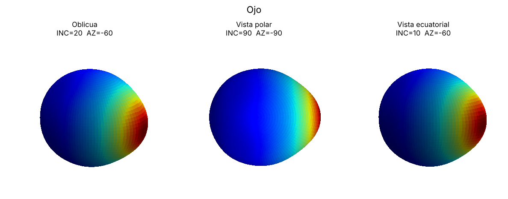

---

## Manzana

**Observación.** Depresiones en ambos polos (se ven en la vista polar y como muescas en la
silueta ecuatorial). Un lado es más alto (rojo) que el opuesto (amarillo).

**Simetría → predicción.** Depresiones iguales en ambos polos y lado alto en el ecuador:
simetría ecuatorial, **solo $n+m$ par**. Lado alto en $\varphi=0$: **todos los $S_{nm}=0$**.
Las depresiones polares son zonales ($C_{n0}$ con $n$ par) y el lado alto requiere $m\ge1$,
principalmente $C_{11}$.

**Función objetivo.**

```python
MANZANA = (crater(90, 0, ancho=18, borde=0.35, radio_borde=40)
           + crater(-90, 0, ancho=18, borde=0.35, radio_borde=40)
           + 0.9 * bulto(0, 0, ancho=60))
```

Relieve $q=2.5$: radio entre 0.75 y 1.10.

| $n$ | $m$ | $C_{nm}$ | $S_{nm}$ |
|---:|---:|---:|---:|
| 0 | 0 | −2.52 | 0 |
| 1 | 1 | −10 | 0 |
| 2 | 0 | −2.99 | 0 |
| 2 | 2 | 1.71 | 0 |
| 3 | 3 | −0.117 | 0 |
| 4 | 0 | −5.41 | 0 |
| 6 | 0 | −2.57 | 0 |

$C_{20}$, $C_{40}$ y $C_{60}$ forman las depresiones polares. $C_{11}$ eleva el lado
$\varphi=0$. $C_{22}>0$ alarga la figura a lo largo del eje $x$. Error de truncamiento: 4 %.

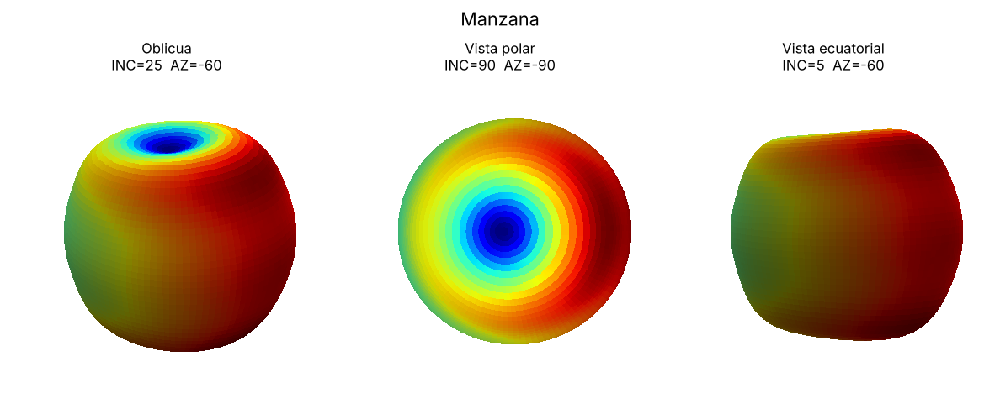

---

## Espiral

**Observación.** En la vista polar hay cuatro lóbulos rojos alternados con cuatro azules.
En la vista lateral las franjas son oblicuas: la posición en longitud de cada lóbulo cambia
con la latitud.

**Simetría → predicción.** Cuatro lóbulos equivalentes: invariancia bajo giros de 90°, así
que **solo $m$ múltiplo de 4**, y con $n\le6$, **solo $m=4$** (más $C_{00}$). La torsión
rompe la simetría ecuatorial y la paridad en $\varphi$, así que deben aparecer términos con
$n+m$ par e impar y senos.

**Función objetivo.**

```python
ESPIRAL = espiral(4, k=1.0, lat=10, ancho=40)     # envolvente(λ) · cos 4(φ − k·λ)
```

Relieve $q=3$: radio entre 0.70 y 1.10.

| $n$ | $m$ | $C_{nm}$ | $S_{nm}$ |
|---:|---:|---:|---:|
| 0 | 0 | −10 | 0 |
| 4 | 4 | 5.06 | 1.01 |
| 5 | 4 | −0.789 | 9.18 |
| 6 | 4 | −9.52 | 0.426 |

**Interpretación.** Desarrollando $\cos 4(\varphi-k\lambda)=\cos4\varphi\cos4k\lambda+\sin4\varphi\sin4k\lambda$:

- $\cos 4k\lambda$ es par en latitud y se acopla a $P_{44}$ y $P_{64}$, que son pares en $z$. Da los términos dominantes $C_{44}$ y $C_{64}$.
- $\sin 4k\lambda$ es impar en latitud y se acopla a $P_{54}\propto\cos\theta\,\sin^4\theta$, que es impar. Da $S_{54}$.
- Los términos menores ($S_{44}$, $C_{54}$, $S_{64}$) proceden de que la envolvente está centrada en 10° N y no en el ecuador.

Como $C_{44}$ y $C_{64}$ tienen signos opuestos, la amplitud de $\cos4\varphi$ es positiva en
el ecuador y negativa en latitudes medias. La de $\sin4\varphi$ cambia de signo entre
hemisferios. Su superposición desplaza los lóbulos en longitud al variar la latitud:

| Latitud | −40° | −20° | 0° | 20° | 40° | 60° |
|---|---:|---:|---:|---:|---:|---:|
| Longitud del lóbulo (coeficientes) | −34.9° | −17.0° | 0.7° | 20.1° | 34.4° | 37.6° |
| Longitud del lóbulo (función objetivo, $k=1$) | −40° | −20° | 0° | 20° | 40° | 60° |

Hasta ±20° de latitud el giro se reproduce fielmente. Más allá se satura, porque con solo
tres funciones de orden 4 la torsión representable es limitada (error de truncamiento del
39 %). Cambiar el signo de $S_{54}$ invierte el sentido de giro.

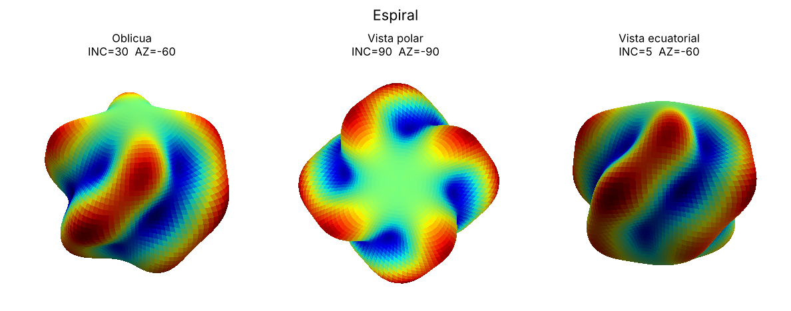

---

## Formas nuevas

Construidas con `formas_nuevas.py`. Cada una ilustra un patrón de coeficientes distinto.

| Forma | Construcción | Simetría | Coeficientes no nulos ($n,m$) |
|---|---|---|---|
| Dado | 8 máximos en los vértices de un cubo | cúbica | (4,0), (4,4), (6,0), (6,4); $C_{44}/C_{40}=2\sqrt{5/14}$ (error $<10^{-8}$) |
| Estrella | 5 lóbulos ecuatoriales + banda ecuatorial | giros de 72°, ecuatorial, par en $\varphi$ | (2,0), (4,0), (5,5), (6,0) |
| Cacahuete | máximos polares + cintura ecuatorial | revolución y ecuatorial | (2,0), (4,0), (6,0) |
| Corazón | dos lóbulos, punta, hendidura | solo par en $\varphi$ | 22 términos, todos los $S_{nm}=0$ |

El corazón ilustra el caso general: con una sola simetría desaparecen los senos, pero
intervienen casi todos los cosenos.

| Dado | Estrella |
|---|---|
| 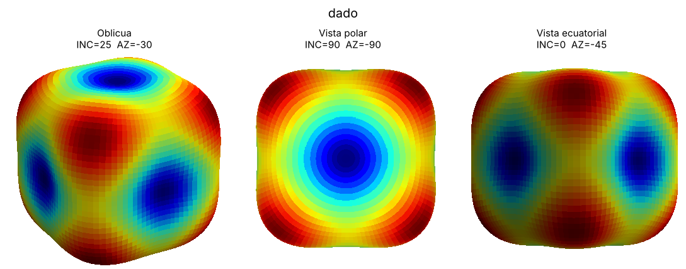 | 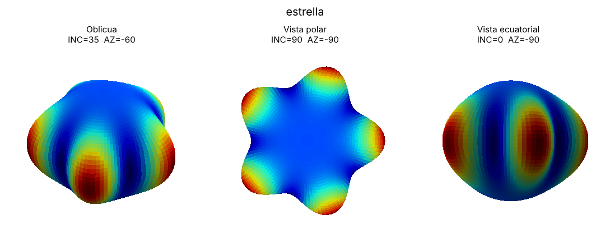 |

| Cacahuete | Corazón |
|---|---|
| 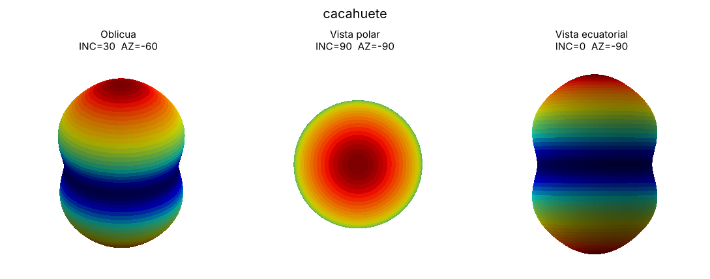 | 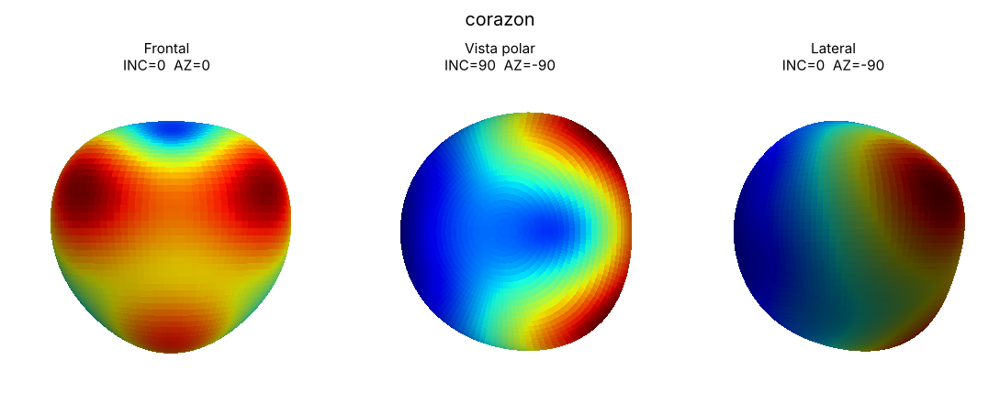 |

Los coeficientes completos están en `resultados/dats/`.

## Exploración

`explorar.py` genera hojas de candidatos por familias (ver [metodo.md §12](metodo.md#12-exploración-de-figuras-nuevas)).
La comparación entre el muestreo independiente y el estructurado muestra por qué el
primero no produce formas reconocibles:

| Muestreo independiente de los 49 coeficientes | Muestreo estructurado: simetría de orden $k$ |
|---|---|
| 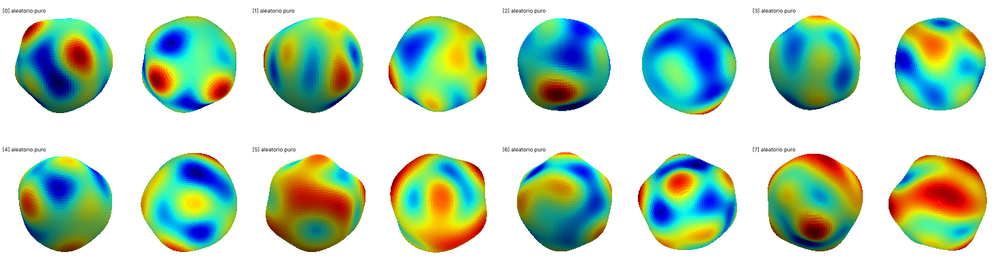 | 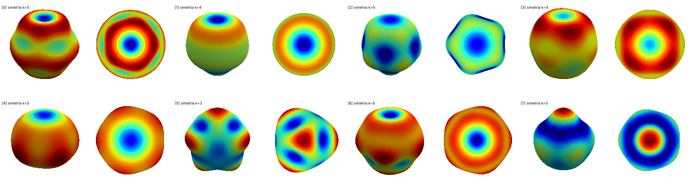 |

El resto de familias está en `resultados/exploracion/`.
