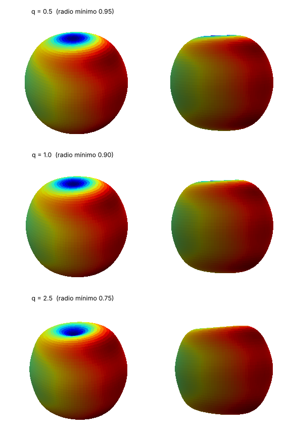
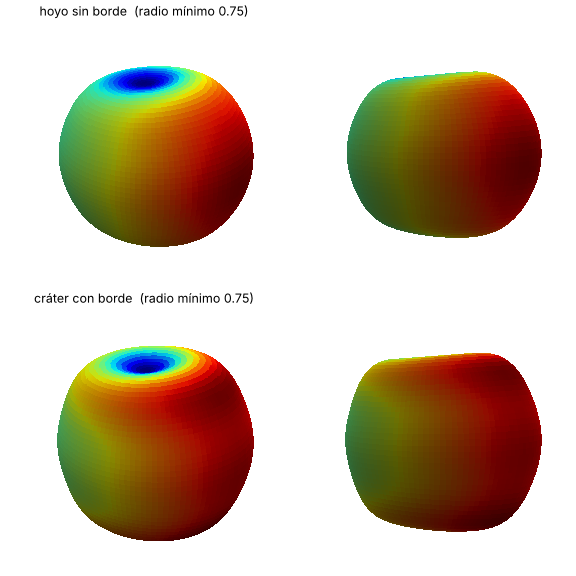

# Método: de una forma a sus coeficientes $C_{nm}$, $S_{nm}$

Este documento desarrolla el procedimiento que siguen `armonicos.py` y `piezas.py`. Cada
afirmación numérica está comprobada en `tests/test_armonicos.py`.

## Índice

1. [Planteamiento](#1-planteamiento)
2. [Base y normalización del script](#2-base-y-normalización-del-script)
3. [Proyección ortogonal](#3-proyección-ortogonal)
4. [Cálculo numérico de las integrales](#4-cálculo-numérico-de-las-integrales)
5. [Construcción de la función objetivo](#5-construcción-de-la-función-objetivo)
6. [Simetrías y coeficientes no nulos](#6-simetrías-y-coeficientes-no-nulos)
7. [Resolución angular y truncamiento](#7-resolución-angular-y-truncamiento)
8. [Relieve: el papel de $C_{00}$](#8-relieve-el-papel-de-c_00)
9. [Depresiones visibles](#9-depresiones-visibles)
10. [Normalización y redondeo](#10-normalización-y-redondeo)
11. [Representación](#11-representación)
12. [Exploración de figuras nuevas](#12-exploración-de-figuras-nuevas)

---

## 1. Planteamiento

El script de la práctica (`original/spheriharm1.py`) resuelve el **problema directo**: dados
los coeficientes, calcula

$$
f(\theta,\varphi)=\sum_{n=0}^{6}\sum_{m=0}^{n} K_{nm}\,P_{nm}(\cos\theta)\,\bigl[C_{nm}\cos m\varphi+S_{nm}\sin m\varphi\bigr]
$$

y dibuja la superficie de radio

$$
\rho(\theta,\varphi)=0.1\left(10+\frac{f}{\max f}\right),
$$

coloreada según el valor de $f$. El apartado b) plantea el **problema inverso**: encontrar
coeficientes que produzcan una forma dada. Buscarlos al azar no es viable (sección 12).
Aquí se sigue otro camino: se describe la forma mediante una función $f(\theta,\varphi)$ y se
calculan sus coeficientes por **análisis armónico**.

```
forma deseada -> f(θ,φ) -> proyección sobre Y_nm (n ≤ 6) -> C, S -> ajuste de C_00 -> .dat -> figura
```

## 2. Base y normalización del script

El script usa

$$
K_{nm}=\sqrt{\frac{2n+1}{4\pi}\,\frac{(n-m)!}{(n+m)!}},
$$

con $P_{nm}$ = `scipy.special.lpmv(m, n, x)`. Esta función **incluye la fase de
Condon-Shortley** $(-1)^m$, por lo que los términos con $m$ impar tienen el signo opuesto
al de las tablas geodésicas. Por ejemplo, $C_{11}>0$ sitúa el máximo en $\varphi=180^\circ$.

Para la proyección hace falta la norma de cada función de la base, con $d\Omega=\sin\theta\,d\theta\,d\varphi$.
Usando $\int_{-1}^{1}P_{nm}^2\,dx=\frac{2}{2n+1}\frac{(n+m)!}{(n-m)!}$:

$$
\int_0^\pi\bigl[K_{nm}P_{nm}(\cos\theta)\bigr]^2\sin\theta\,d\theta
=\frac{2n+1}{4\pi}\frac{(n-m)!}{(n+m)!}\cdot\frac{2}{2n+1}\frac{(n+m)!}{(n-m)!}=\frac{1}{2\pi}.
$$

Como $\int_0^{2\pi}\cos^2 m\varphi\,d\varphi$ vale $2\pi$ si $m=0$ y $\pi$ si $m>0$:

$$
\bigl\lVert K_{nm}P_{nm}\cos m\varphi\bigr\rVert^2=
\begin{cases}1 & m=0\\ 1/2 & m>0\end{cases}
\qquad\text{(igual para el seno con } m>0\text{).}
$$

## 3. Proyección ortogonal

Con el producto escalar $\langle g,h\rangle=\int g\,h\,d\Omega$, las funciones de la base son
ortogonales:

- en $\varphi$, $\int_0^{2\pi}\cos m\varphi\cos m'\varphi\,d\varphi=0$ si $m\neq m'$, y senos y cosenos son ortogonales entre sí;
- en $\theta$, para un mismo $m$, los $P_{nm}$ con distinto $n$ son ortogonales.

Si $f=\sum C_{nm}(\dots)+S_{nm}(\dots)$, al multiplicar por una función de la base e
integrar sobrevive un único término, y se despeja:

$$
C_{nm}=(2-\delta_{m0})\int f\,K_{nm}P_{nm}(\cos\theta)\cos m\varphi\,d\Omega,\qquad
S_{nm}=2\int f\,K_{nm}P_{nm}(\cos\theta)\sin m\varphi\,d\Omega\ \ (m>0).
$$

El factor $2-\delta_{m0}$ es el inverso de la norma al cuadrado.

**Optimalidad.** Si $f$ no es exactamente una suma de grado $\le 6$, estos coeficientes
definen su proyección ortogonal $f_6$. El residuo $f-f_6$ es ortogonal a todo el subespacio,
de modo que, por el teorema de Pitágoras, cualquier otra combinación de grado $\le 6$ está
más lejos de $f$. Los coeficientes obtenidos son, por tanto, **el ajuste por mínimos
cuadrados sobre la esfera**: el análogo esférico de truncar una serie de Fourier.

## 4. Cálculo numérico de las integrales

Con el cambio $x=\cos\theta$, $d\Omega=dx\,d\varphi$, y `proyectar` usa:

- **Gauss-Legendre** con 64 nodos en $x\in[-1,1]$, exacta para polinomios de grado $\le 127$;
- **regla del trapecio periódica** con 128 puntos en $\varphi$, exacta para frecuencias $<128$.

$$
\int g\,d\Omega\approx\sum_i\sum_j w_i\,g(x_i,\varphi_j)\,\Delta\varphi,\qquad \Delta\varphi=\frac{2\pi}{128}.
$$

El producto de dos funciones de la base con el mismo $m$ es un polinomio en $x$, así que
para funciones de grado $\le 6$ la cuadratura es exacta. Se comprueba sintetizando $f$ a
partir de 49 coeficientes aleatorios y proyectándola de nuevo: el error es $<10^{-10}$
(`test_proyeccion_recupera_los_coeficientes`).

La síntesis (`sintetizar`) reproduce la del script con diferencia nula sobre su malla
(`test_sintesis_identica_al_script`), y la lectura de ficheros es idéntica a la suya
(`test_lectura_identica_al_script`).

## 5. Construcción de la función objetivo

`piezas.py` define funciones sencillas que se combinan linealmente. Como la proyección es
lineal, los coeficientes de una suma de piezas son la suma de sus coeficientes. La mayoría
se basan en la distancia angular $\gamma$ a un punto $(\theta_0,\varphi_0)$:

$$
\cos\gamma=\sin\theta\sin\theta_0\cos(\varphi-\varphi_0)+\cos\theta\cos\theta_0 .
$$

| Pieza | Expresión | Uso |
|---|---|---|
| `bulto(lat, lon, σ)` | $e^{-\gamma^2/2\sigma^2}$; con `punta=True`, $e^{-\gamma/\sigma}$ | Máximos locales |
| `hoyo` | $-$`bulto` | Mínimos locales |
| `crater` | $-e^{-\gamma^2/2\sigma^2}+b\,e^{-(\gamma-r_0)^2/2w^2}$ | Depresión visible (sección 9) |
| `banda(lat, σ)` | gaussiana en latitud | Anillos zonales |
| `lobulos(m, ...)` | envolvente en latitud $\times\cos m(\varphi-\varphi_0)$ | $m$ lóbulos |
| `espiral(m, k, ...)` | envolvente en latitud $\times\cos m(\varphi-k\,\lambda)$ | Lóbulos cuya fase gira con la latitud $\lambda$ |

`bulto_axial` en `armonicos.py` ofrece la vía analítica para un patrón axisimétrico en torno
a un eje arbitrario, mediante el teorema de adición:

$$
P_n(\cos\gamma)=\sum_{m=0}^{n}\varepsilon_m\frac{(n-m)!}{(n+m)!}P_{nm}(\cos\theta)P_{nm}(\cos\theta_0)\cos m(\varphi-\varphi_0),
\qquad \varepsilon_0=1,\ \varepsilon_{m>0}=2,
$$

verificado con error $<10^{-10}$ (`test_teorema_de_adicion`).

## 6. Simetrías y coeficientes no nulos

Las integrales de la sección 3 determinan qué coeficientes se anulan según las simetrías de $f$:

| Simetría de $f$ | Consecuencia | Motivo |
|---|---|---|
| Revolución en torno a $z$ | solo $m=0$ | $\int_0^{2\pi}\cos m\varphi\,d\varphi=0$ para $m\neq0$ |
| Invariante bajo giros de $360^\circ/k$ | solo $m$ múltiplo de $k$ | al girar $2\pi/k$, el término de orden $m$ adquiere la fase $e^{i2\pi m/k}$, que debe valer 1 |
| Par en $\varphi$: $f(\theta,-\varphi)=f(\theta,\varphi)$ | todos los $S_{nm}=0$ | $\sin m\varphi$ es impar |
| Simétrica respecto al ecuador | solo $n+m$ par | $P_{nm}(-x)=(-1)^{n+m}P_{nm}(x)$ |

`piezas.simetrias` aplica estas reglas a la salida, y los tests las comprueban para cada figura.

**Ejemplo: simetría cúbica.** Ocho máximos iguales en los vértices de un cubo (`dado`)
tienen simetría de orden 4 en torno a $z$, simetría ecuatorial y paridad en $\varphi$. Solo
sobreviven $C_{40}$, $C_{44}$, $C_{60}$ y $C_{64}$. Además, la simetría cúbica obliga a que la
componente de grado 4 sea el armónico cúbico, lo que fija el cociente

$$
\frac{C_{44}}{C_{40}}=2\sqrt{\frac{5}{14}}\approx1.19523
$$

**independientemente de la forma de los máximos**. El cálculo lo reproduce con error
$<10^{-8}$ (`test_simetria_cubica_del_dado`), lo que valida a la vez la normalización y la
proyección.

## 7. Resolución angular y truncamiento

Un armónico de grado $n$ tiene detalles de tamaño angular $\sim180^\circ/n$, así que con
$n\le6$ el detalle más fino representable es de unos $30^\circ$. La relación es análoga a la
de incertidumbre: cuanto más estrecha es una pieza en ángulo, más ancho es su espectro en
$n$. Para una gaussiana de anchura $\sigma$ pequeña, el peso del grado $n$ decae
aproximadamente como $e^{-n(n+1)\sigma^2/2}$.

`piezas.error_truncamiento` mide qué parte de la variación de $f$ queda fuera:

$$
\varepsilon=\frac{\lVert f-f_6\rVert}{\lVert f-\langle f\rangle\rVert}.
$$

`construir` avisa cuando $\varepsilon>35\,\%$. Valores de las figuras del guion: ojo 6 %,
manzana 4 %, bombilla 13 % y espiral 39 %. En la espiral, con $m=4$ solo existen tres
funciones ($n=4,5,6$), insuficientes para una torsión continua. Una torsión mayor que
$k\approx1$ degenera en un patrón de tablero de ajedrez.

## 8. Relieve: el papel de $C_{00}$

$Y_{00}=K_{00}=1/\sqrt{4\pi}$ es constante, así que modificar $C_{00}$ desplaza $f$ en una
constante $c$. Eso tiene dos efectos distintos:

- **Colores:** no cambian, porque la escala de color va del mínimo al máximo de $f$.
- **Radio:** sí cambia, porque $\max f$ está en el denominador. Con $M=\max f$ y $m=\min f$,
  $$\rho_{\max}=1.1,\qquad \rho_{\min}=1+0.1\,\frac{m-c}{M-c}.$$

Si $f$ tiene la forma «máximos sobre un fondo casi nulo» ($m/M\approx0$), las zonas de
menor valor quedan en $\rho\approx1$ y no se hunden. `fijar_relieve(C, S, q)` elige $c$ para
que $\rho_{\min}=1-0.1\,q$:

$$
\frac{m-c}{M-c}=-q\ \Longrightarrow\ c=\frac{m+qM}{1+q},\qquad \Delta C_{00}=-c\sqrt{4\pi}.
$$

Como $M-c=(M-m)/(1+q)>0$, la figura nunca se invierte ni diverge, que es lo que ocurre si
$\max f\le0$. Así, $q=1$ da un relieve simétrico de $\pm10\,\%$ y $q=3$ hunde el mínimo
hasta el 70 % del radio. El test `test_fijar_relieve` comprueba que solo cambia $C_{00}$, que
$f$ varía en una constante y que los radios son los indicados.



## 9. Depresiones visibles

Que $f$ tenga un mínimo local no basta para que la superficie muestre una depresión. Cerca
del polo, la altura de la superficie es

$$
z=\rho\cos\gamma\approx\rho\left(1-\frac{\gamma^2}{2}\right),
$$

así que la esfera ya desciende al alejarse del punto. Para que el centro quede por debajo
de su entorno, $\rho$ debe crecer con $\gamma$ más deprisa que esa caída. Un mínimo gaussiano
sobre un fondo plano no lo consigue; un mínimo rodeado de un **anillo elevado** sí. Es lo que
implementa `crater`.

En la manzana, con $q=3$, la profundidad de la muesca en la silueta es de $0.002$ radios
sin borde y de $0.13$ con borde (`test_crater_produce_depresion_en_la_silueta`).



## 10. Normalización y redondeo

Multiplicar todos los coeficientes por $\lambda>0$ multiplica $f$ por $\lambda$ y deja
$f/\max f$ invariante, así que la figura es la misma. Por eso los coeficientes están
determinados salvo un factor de escala. `limpiar`:

1. normaliza a $\max|c|=10$;
2. anula los coeficientes menores que el 1 % del mayor;
3. redondea a tres cifras significativas y fija $S_{n0}=0$, que no contribuye porque $\sin 0=0$;
4. devuelve el error relativo introducido, inferior al 1,1 % en todas las figuras.

`escribir_dat` reproduce el formato del fichero original, con los ceros escritos como `1e-6`.

## 11. Representación

`dibujar` usa la misma superficie y la misma escala de color que el script, con dos
diferencias de presentación que no alteran la figura:

- **Aspecto 1:1:1.** Por defecto, matplotlib dibuja los ejes 3D en una caja 4:4:3, que
  comprime el eje $z$ un 25 % y atenúa el relieve de los polos.
- **Iluminación direccional.** Sin sombreado, una zona hundida y una saliente del mismo color
  son indistinguibles.

`spheriharm1_corregido.py` aplica exactamente estos dos cambios al script original. Su
`diff` con `original/spheriharm1.py` se limita a esas líneas, y `ejecutar_original.py`
permite generar ambas versiones con cualquier `.dat`.

## 12. Exploración de figuras nuevas

**Por qué el muestreo independiente no funciona.** Con 49 coeficientes independientes de
varianza $\sigma^2$, la contribución del grado $n$ a $\langle f^2\rangle$ es
$\sigma^2\bigl(1+n\cdot\tfrac12\cdot2\bigr)=(n+1)\sigma^2$ (sección 2): crece con $n$. Los
grados altos dominan, todas las muestras son irregulares y de aspecto similar, y la
probabilidad de obtener una simetría reconocible es despreciable
(`resultados/exploracion/aleatorio_puro_s0.png`).

**Muestreo estructurado.** `explorar.py` sortea unos pocos parámetros con significado
geométrico y después proyecta o construye los coeficientes. Cada familia ocupa un subespacio
con una simetría definida:

| Familia | Parámetros sorteados | Coeficientes |
|---|---|---|
| `zonal` | $C_{n0}$ con decaimiento $n^{-a}$ | solo $m=0$ |
| `simetria_m` | orden $k\in\{2,\dots,5\}$ | solo $m$ múltiplo de $k$ |
| `espiral` | $m$, torsión $k$, latitud y anchura | solo el $m$ sorteado |
| `bultos` | 2–5 máximos/mínimos en puntos uniformes de la esfera | todos |
| `dispersa` | 2–3 armónicos aislados | los sorteados |
| `espectral` | varianza por coeficiente $\propto n^{-\beta}$, $\beta\in[2,4]$ | todos, con espectro decreciente como el del geoide |
